# Trivia

**Preguntas, participación y evaluación en el aula.**

Trivia es una app para docentes que permite organizar una evaluación con preguntas de opción múltiple desde una tableta Android. El docente conduce la actividad: prepara la lista de estudiantes, lee las preguntas, registra las respuestas y consulta los resultados. Los turnos, el tiempo, los robos y los puntajes se gestionan en la app.

Se puede adaptar a distintas materias mediante bancos de preguntas propios. Incluye un banco de **200 preguntas de Antigüedad, Unidad IV**, con cuatro alternativas y una explicación por pregunta.

Es **gratuita y funciona sin conexión**, sin cuentas, anuncios ni compras. Está diseñada para tabletas, tanto en horizontal como en vertical.

## Ubicá las botoneras

La cápsula de herramientas reúne **Cómo evaluar, Configuración y Sonidos**. La de navegación abre **Estudiantes, Evaluación, Resultados y Banco**; el fondo de color indica la sección seleccionada.

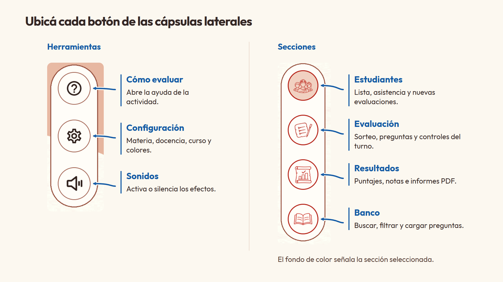

Con una pregunta activa, en horizontal la navegación se acopla junto a la barra inferior. En vertical, los controles quedan al costado y los datos de quien responde se muestran sobre la pregunta. Las funciones son las mismas.

## Cómo se usa en clase

### 1. Prepará la evaluación

Configurá la materia, el tema o unidad, la comisión, el docente y, si corresponde, el ayudante de cátedra. Podés elegir entre cinco paletas de colores.

El **nombre corto** de la materia se usa en la cabecera; el nombre completo identifica la asignatura en los informes. La paleta se previsualiza al elegirla: **Guardar** se habilita cuando hay cambios válidos y los aplica; **Cancelar** conserva la configuración anterior. Los aciertos y errores mantienen sus marcas verdes y rojas con cualquier paleta.

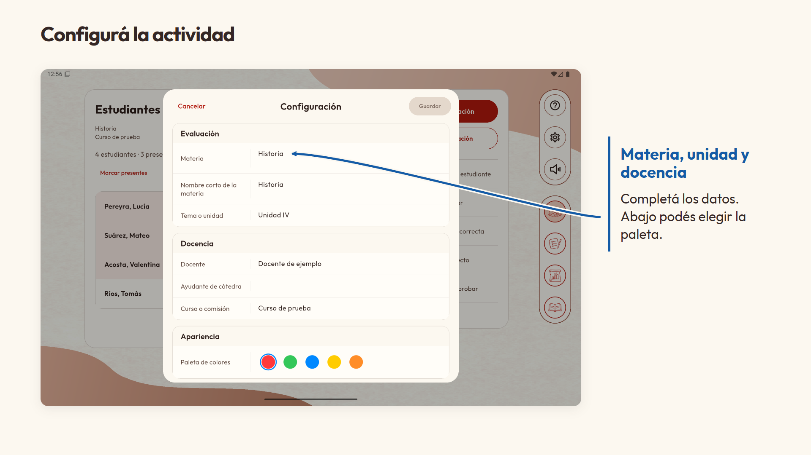

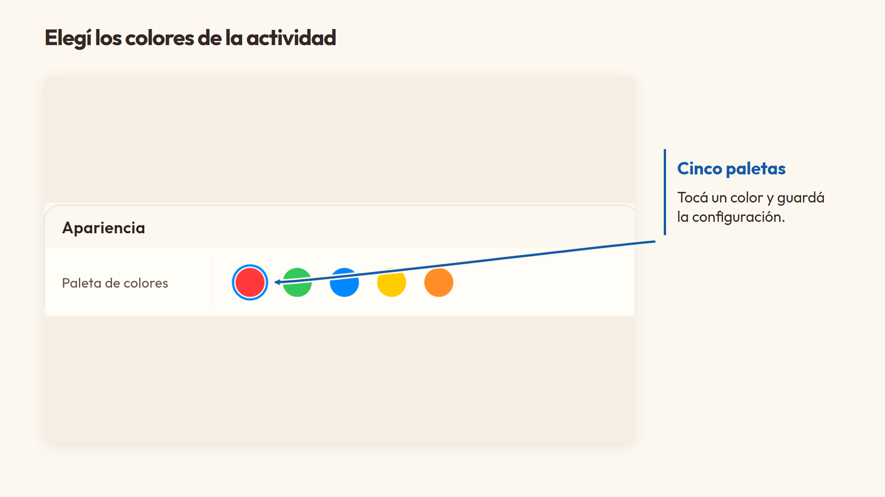

En **Estudiantes**, revisá los nombres y marcá presentes y ausentes. Podés cargar una lista propia y corregir un nombre manteniendo presionada su fila. Antes de comenzar también se pueden eliminar estudiantes.

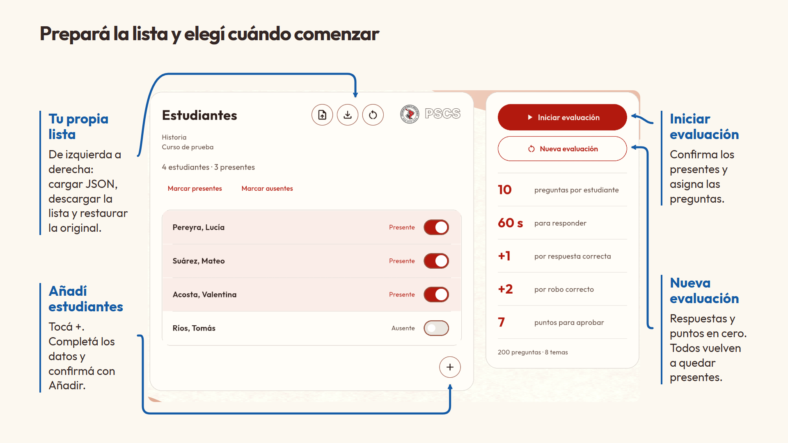

Cada fila tiene un interruptor de asistencia. Quienes figuran como ausentes quedan fuera del sorteo.

Antes de empezar, **Marcar presentes** y **Marcar ausentes** cambian la asistencia de toda la lista. Tiene que haber al menos una persona presente para iniciar.

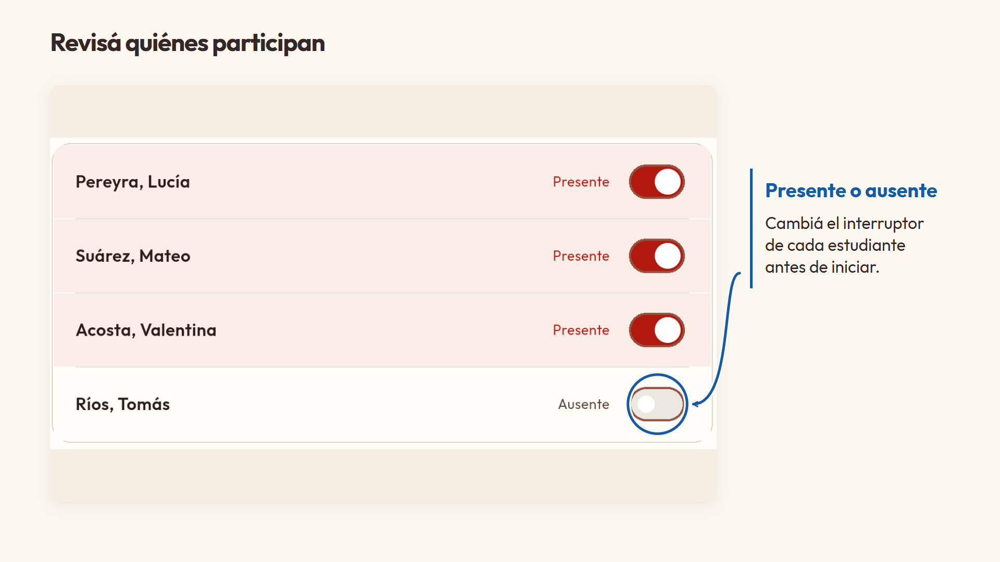

Para corregir un nombre, mantené presionada la fila y guardá los cambios en el cuadro de edición.

También podés **añadir estudiantes manualmente**: tocá el botón **+** debajo de la lista. Se abre **Nuevo estudiante**; completá Apellido y Nombre y tocá **Añadir**. Cancelar conserva la lista. La eliminación está disponible antes de iniciar, siempre que quede al menos un estudiante. Corregir un nombre durante la evaluación conserva sus respuestas y puntos.

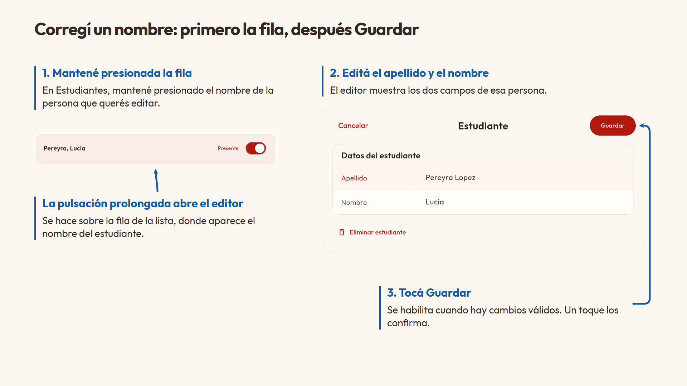

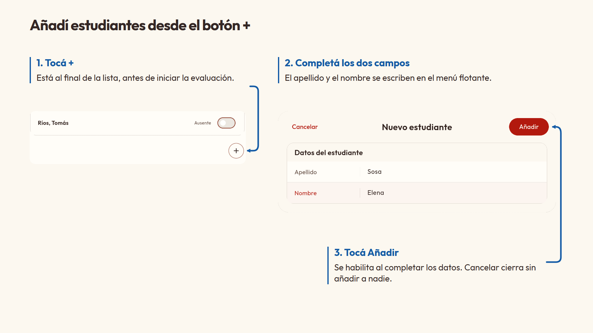

La app admite **hasta 20 estudiantes** y reserva **10 preguntas distintas para cada uno**. El banco debe alcanzar para todas las personas registradas, incluidos los ausentes: una lista de 15 estudiantes necesita al menos 150 preguntas.

### 2. Iniciá y sorteá un turno

Los turnos se sortean entre quienes están presentes y siguen participando, priorizando a quienes tuvieron menos preguntas. Cada estudiante recibe preguntas de su conjunto reservado.

Después de iniciar la evaluación, tocá **Sortear siguiente turno** en la tarjeta central. La app elige la persona y muestra la pregunta con el reloj todavía sin iniciar.

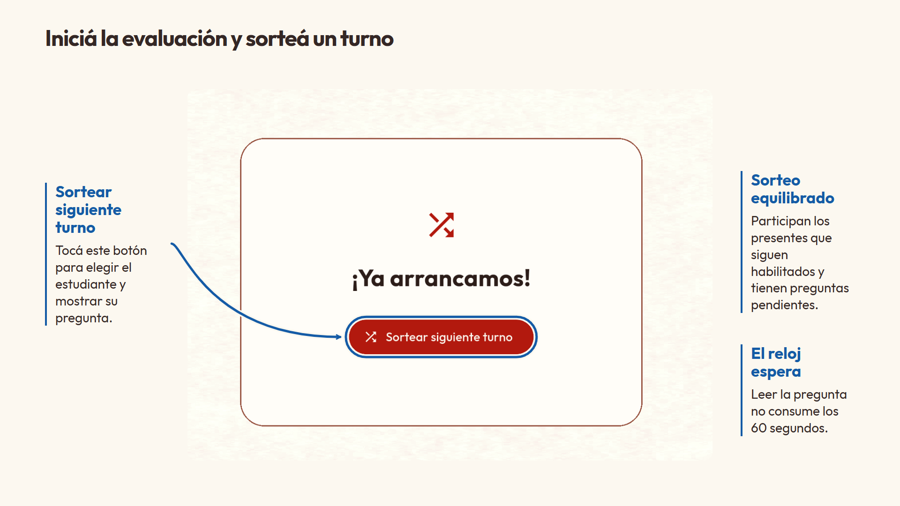

Leé el enunciado y las cuatro alternativas en voz alta. Después tocá **«Iniciar tiempo»**: hay **60 segundos** para responder, sin descontar el tiempo de lectura. El docente registra la opción elegida, de A a D.

La barra muestra el **nombre**, sus **puntos acumulados**, el **avance de preguntas** y el **reloj**. **1/10** significa «primera pregunta propia del titular, de diez»; no es una nota. El botón de triángulo inicia el tiempo, el de salto registra **No contesta** y la flecha curva es **Deshacer**.

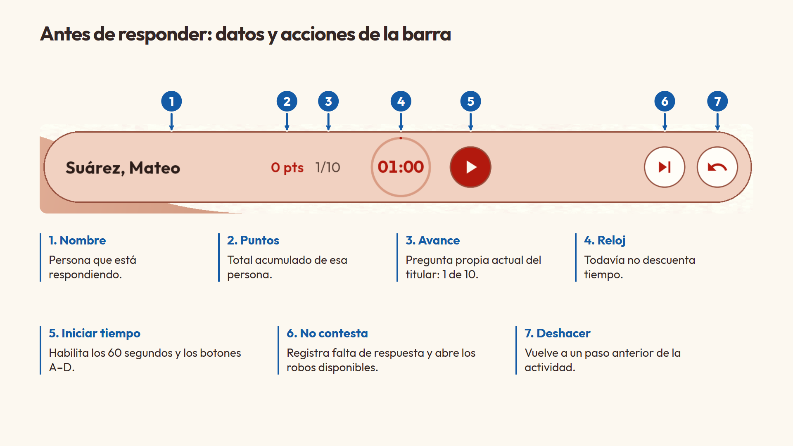

La respuesta se registra con los **botones A–D de la barra**, usando la letra que aparece en pantalla. Las tarjetas de las alternativas son de lectura; la app baraja su orden al preparar la evaluación. Si una pregunta o su explicación ocupa más espacio, desplazá el contenido dentro de la tarjeta para leerlo completo.

Mientras corre el tiempo, **tocá el reloj para pausarlo** y volvé a tocarlo para reanudar. El reloj también se pausa al salir de Evaluación, abrir la ayuda, la configuración o un informe, o dejar la app en segundo plano. Al volver, reanudalo cuando corresponda.

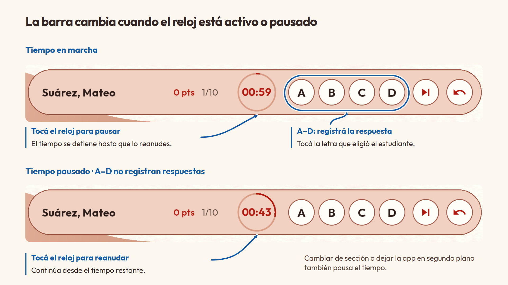

### 3. Resolvé la respuesta y los robos

Si la respuesta es incorrecta, no contesta o se agota el tiempo, podés elegir a otro estudiante habilitado para intentar un **robo**. Hay hasta **dos intentos de robo por pregunta**, con un intento por persona.

El selector ofrece estudiantes presentes que siguen participando, distintos del titular y de quienes ya intentaron robar esa pregunta. Elegí una persona y tocá **Iniciar robo**. Los robos **no tienen un nuevo cronómetro de 60 segundos** y no consumen las diez preguntas propias de quien roba. Las alternativas ya elegidas quedan marcadas y bloqueadas.

Al elegir un candidato, la barra pasa a mostrar **su nombre y sus puntos**. Durante el robo conserva esos datos; al mostrar el resultado, corresponden a quien acaba de responder. El avance **1/10** sigue refiriéndose a la pregunta propia del titular.

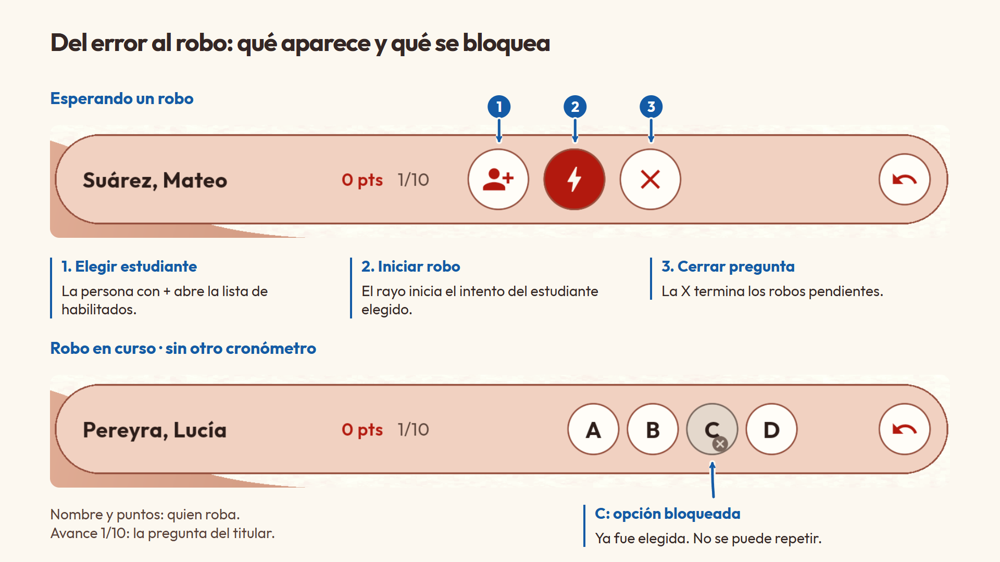

La respuesta correcta y la explicación quedan disponibles para revisar al cerrar la pregunta. Después se puede avanzar al siguiente turno. **Deshacer** permite corregir un registro equivocado.

**Correcto** lleva una tilde verde; **Incorrecto** y **Sin respuesta**, una cruz. El resultado informa lo registrado. El **ojo** abre la explicación y se convierte en un botón de **giro** para volver a las opciones. La **flecha hacia la derecha** avanza al siguiente turno; la **flecha curva** deshace un paso.

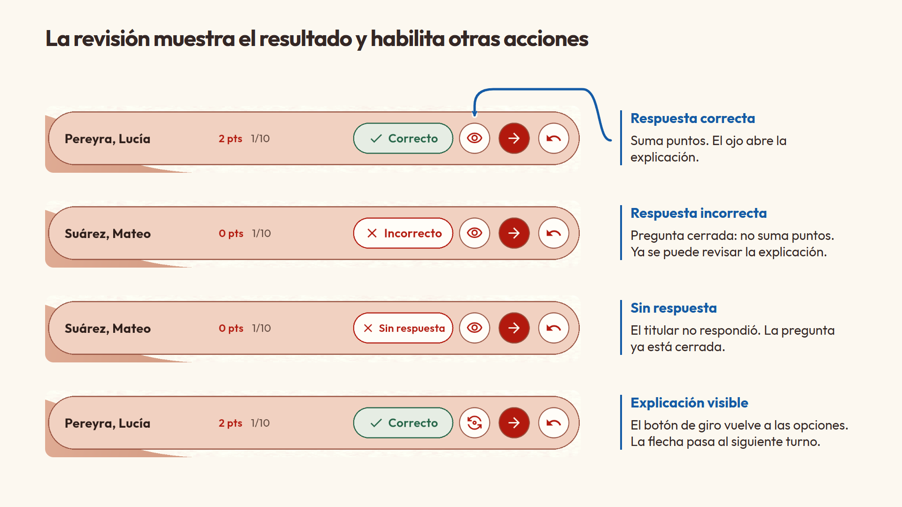

#### Qué controles aparecen en cada momento

| Momento | Qué muestra la barra | Qué podés hacer |
| --- | --- | --- |
| **Lectura** | Nombre, puntos, avance y 01:00 sin descontar. | Iniciar tiempo, registrar No contesta o deshacer un paso disponible. |
| **Respuesta con tiempo** | El reloj descuenta y aparecen A–D. | Registrar una alternativa, tocar el reloj para pausar o usar No contesta. |
| **Pausa** | El reloj queda detenido y las letras siguen visibles. | Reanudar con el reloj o usar No contesta. A–D no registran respuestas mientras está pausado. |
| **Espera de robo** | Persona con +, rayo y X. | Elegir estudiante, iniciar su robo o cerrar la pregunta sin más intentos. Si tocás el rayo sin candidato, abre el selector. |
| **Robo en curso** | Nombre y puntos de quien roba, A–D y alternativas usadas en gris. | Registrar una opción disponible. No hay reloj nuevo; las alternativas ya elegidas están bloqueadas. |
| **Revisión** | Correcto, Incorrecto o Sin respuesta; ojo y flecha de avance. | Abrir la explicación, avanzar al siguiente turno o deshacer un paso. |
| **Explicación visible** | El texto explicativo y el botón de giro en lugar del ojo. | Volver a las opciones, avanzar o deshacer. |

**No contesta** permite pasar a los robos sin esperar al vencimiento. **Cerrar pregunta** termina los robos pendientes; si no hay candidatos o se agotan los dos intentos, el cierre es automático. **Deshacer** recupera un paso anterior y sus puntos; si vuelve a una pregunta con tiempo, queda pausada. No revierte correcciones de nombres y solo está disponible cuando hay un paso al que volver.

El estado **Sin respuesta** puede corresponder a No contesta o a tiempo agotado; el PDF distingue las dos situaciones. El ojo permanece oculto mientras haya intentos pendientes. Los avisos de aprobación y nota máxima se explican en **Cómo se puntúa**.

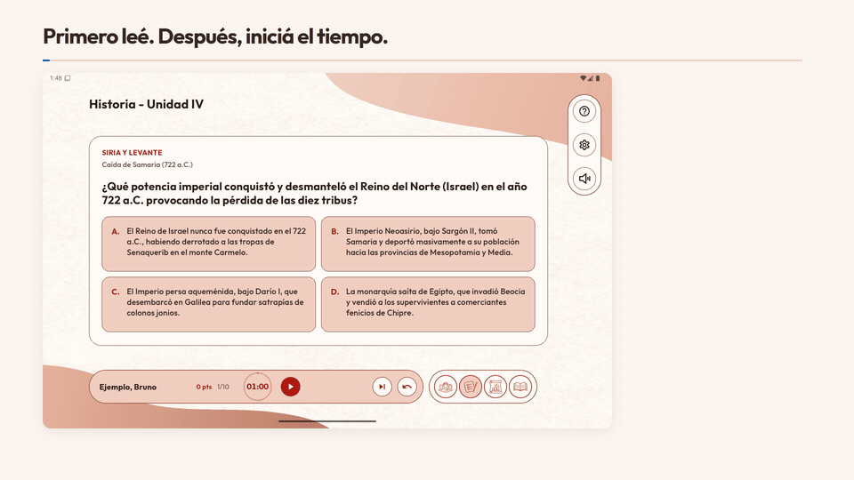

[Ver el turno con sonido](docs/guia-visual/trivia-turno.mp4).

### 4. Consultá los resultados

En **Resultados** podés seguir los puntajes, las notas y la participación de cada estudiante. Desde ahí se abren los informes individuales o todos los informes reunidos en un único PDF.

**Correctas** cuenta los aciertos en preguntas propias y **Robos** los robos acertados; **Puntos** suma sus valores y **Nota** expresa el resultado sobre diez. Los ausentes aparecen identificados, con guiones en puntos y nota. Mientras la evaluación del grupo sigue abierta, la columna **Resultado** muestra «En curso», aunque una persona ya haya recibido su aviso de aprobación.

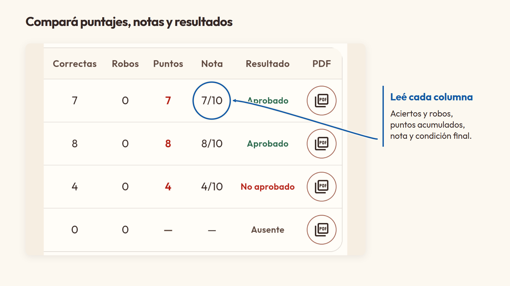

Cuando ya no quedan estudiantes presentes con participación abierta y preguntas propias pendientes, el siguiente avance lleva a **Evaluación finalizada**. Desde esa pantalla podés ir a los resultados o iniciar otra evaluación.

### 5. Empezá otra evaluación

**Nueva evaluación** está disponible en Estudiantes y al finalizar la actividad. Pide confirmación, conserva los nombres, el banco de preguntas y la configuración, y empieza con respuestas y puntos en cero. **Todos vuelven a quedar presentes**, por lo que conviene revisar la asistencia antes de iniciar el nuevo grupo de turnos.

## Cómo se puntúa

| Resultado | Puntaje |
| --- | --- |
| Respuesta correcta en su pregunta | 1 punto |
| Robo correcto | 2 puntos, hasta alcanzar el máximo de 10 |
| Respuesta incorrecta o sin respuesta | 0 puntos; no se descuentan puntos |

La aprobación es desde **7 puntos** y la nota máxima es **10**. Los puntos de las preguntas propias y de los robos se acumulan, sin superar ese máximo: si tiene 9 y acierta un robo, llega a 10.

Las diez preguntas propias son oportunidades de respuesta, no puntos garantizados. Los robos son participaciones adicionales: quien ya respondió sus diez preguntas propias puede seguir apareciendo para robar mientras la evaluación esté abierta y su participación no haya finalizado.

### Al alcanzar la aprobación

Cuando un estudiante alcanza o supera los **7 puntos** por primera vez, aparece un aviso con dos opciones:

- **Finalizar:** termina la evaluación de esa persona con el puntaje alcanzado; deja de participar en los turnos y robos.
- **Continuar:** sigue participando para intentar mejorar su nota, hasta llegar a 10 o completar su participación.

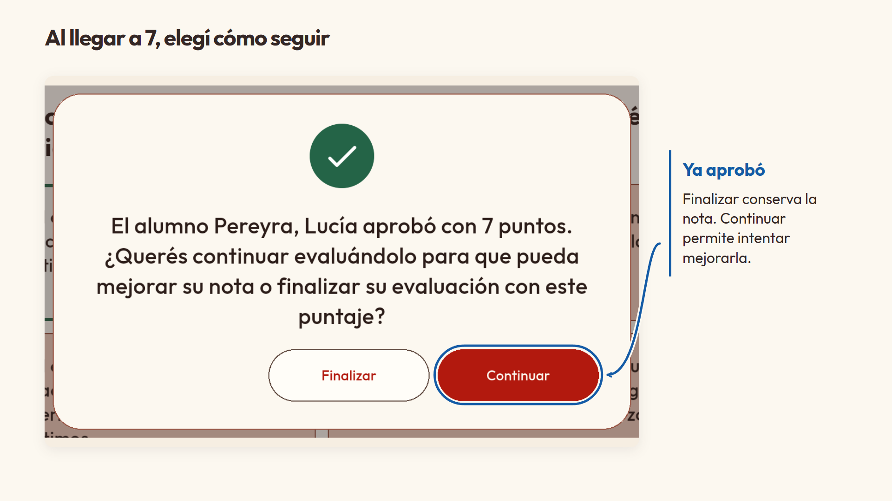

### Al llegar a la nota máxima

Al alcanzar **10 puntos**, la participación de ese estudiante termina automáticamente: deja de entrar en el sorteo y de estar habilitado para los robos. La app muestra un aviso de nota máxima. En este caso, **Continuar** cierra el aviso para seguir con el resto del grupo; no vuelve a habilitar a esa persona.

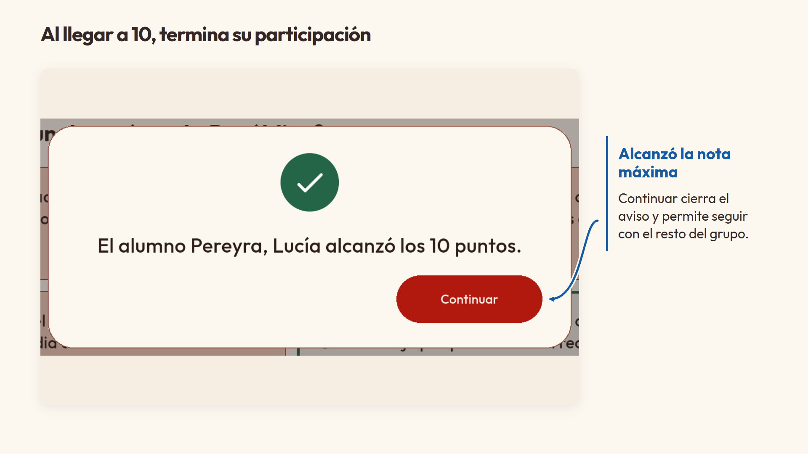

## Tus preguntas y tus estudiantes

Podés preparar Trivia para otra materia cargando un **banco de preguntas en formato JSON**. Cada pregunta incluye un tema, un enunciado, cuatro opciones, la respuesta correcta y una explicación. El banco se puede consultar y filtrar por tema desde la sección **Banco**.

Se admiten bancos de **10 a 2000 preguntas**, en archivos de hasta **2 MB**, siempre que alcancen para reservar diez por estudiante. Las preguntas adicionales quedan en reserva. Para editar un banco, descargá su plantilla y modificá el JSON fuera de la app; la plantilla exportada contiene las preguntas del banco que esté cargado.

Cuando usás un banco personalizado aparece **Usar banco predeterminado**, que recupera el banco de Unidad IV. Esta acción está habilitada antes de iniciar o después de finalizar; si la evaluación está en curso, primero creá una nueva.

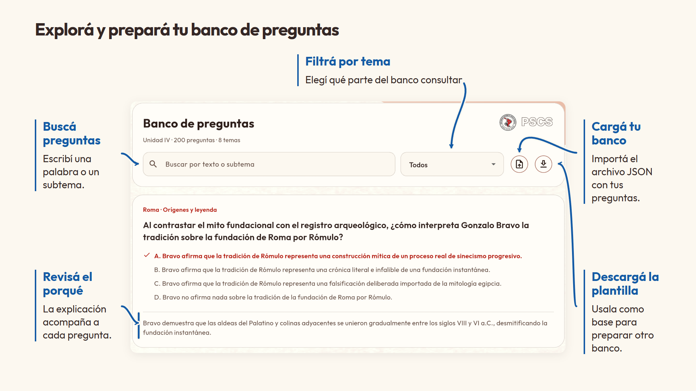

Para revisar una parte del banco, elegí un tema en el menú. La búsqueda consulta el enunciado, el subtema y las alternativas, y se puede combinar con el filtro por tema. **Todos** elimina el filtro de tema; para volver a ver el banco completo, borrá también el texto de búsqueda.

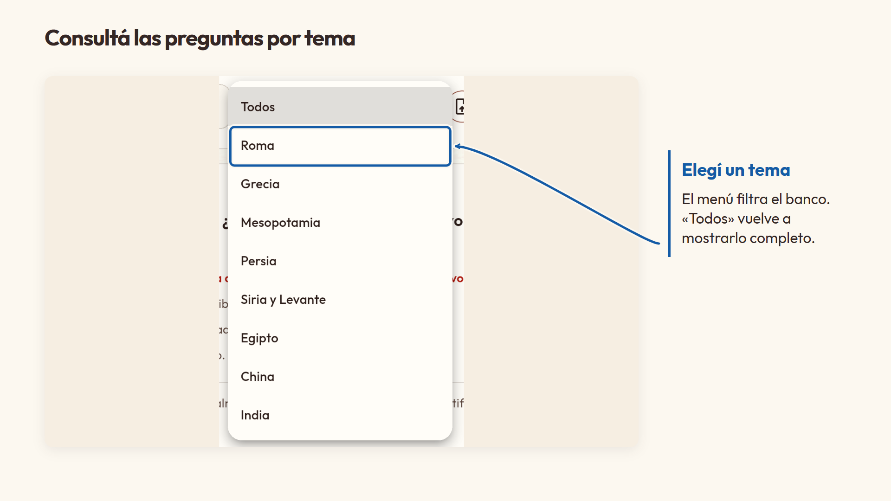

La lista de estudiantes también se puede cargar desde un archivo JSON de hasta **256 KB** o descargar como plantilla con los nombres y la asistencia actuales. El botón **Restaurar estudiantes predeterminados** recupera la lista original y pide confirmar el reemplazo. Tanto la carga como la restauración crean una nueva evaluación si ya había una iniciada.

| Qué querés preparar | Plantilla | Guía |
| --- | --- | --- |
| Banco de preguntas | [Descargar plantilla](output/Plantilla-banco-preguntas.json) | [Cómo preparar las preguntas](output/Guia-bancos-JSON.md) |
| Lista de estudiantes | [Descargar plantilla](output/Plantilla-estudiantes.json) | [Cómo preparar la lista](output/Guia-estudiantes-JSON.md) |

Si reemplazás el banco o la lista cuando la evaluación ya comenzó, se solicita confirmar una evaluación nueva, con puntajes en cero; la anterior queda guardada. Cancelar la carga o elegir un archivo inválido conserva los datos actuales.

## Informes para revisar y compartir

Los PDF incluyen la identificación de la evaluación, los datos docentes y el registro de cada estudiante: preguntas, alternativas, respuestas, intentos de robo y resultado. Las marcas permiten distinguir aciertos y errores. El informe individual indica si es **parcial o final**: puede ser final cuando esa persona ya terminó, aunque el grupo siga siendo evaluado.

Se pueden abrir **desde que se inicia la evaluación**, sin esperar al cierre del grupo. El detalle distingue respuestas incorrectas, falta de respuesta, tiempo agotado y preguntas todavía no planteadas. También registra las participaciones en preguntas de otras personas y el tiempo activo de las respuestas propias, sin sumar la lectura ni las pausas.

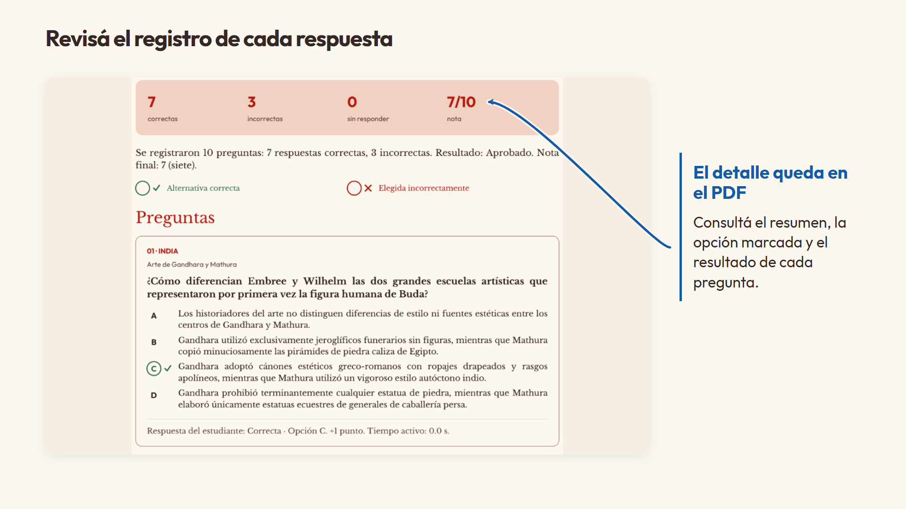

Podés **guardar, compartir o imprimir** un informe individual. La opción **«Todos los informes (PDF)»** reúne los informes en un solo documento, con portada y numeración por estudiante.

En el visor, las flechas cambian de página y el contador indica dónde estás. Podés **ampliar con dos dedos y arrastrar** para recorrer el detalle; al cambiar de página vuelve al encuadre inicial. Los PDF exportados conservan texto seleccionable, los datos docentes y la paleta de la evaluación.

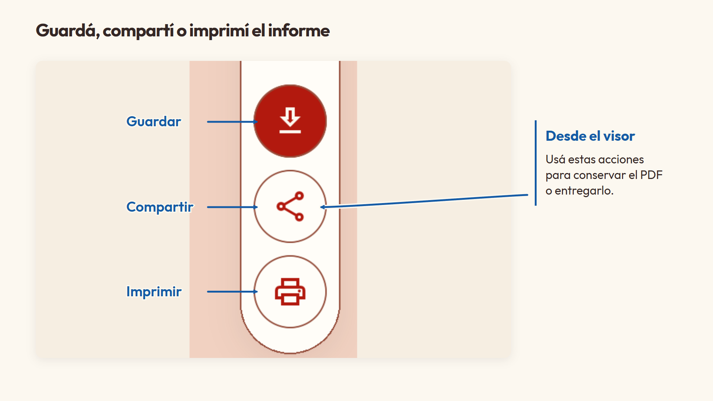

## Progreso y privacidad

La evaluación, el banco personalizado y las preferencias se guardan localmente para continuar después. Al recuperar una evaluación, el tiempo queda pausado. **Deshacer** conserva hasta veinte pasos durante la sesión abierta; ese historial de pasos no se recupera al cerrar y volver a abrir la app.

Podés corregir la asistencia durante la actividad. Si marcás ausente a quien estaba respondiendo, se suspende ese turno; si estaba robando, se cancela su intento. Los ausentes dejan de aparecer como candidatos a nuevos turnos y robos.

El botón **Cómo evaluar** abre la ayuda dentro de la app; el de **sonido** permite activar o silenciar los efectos. La interfaz respeta la preferencia de movimiento reducido del dispositivo. Si aparece un aviso de que no se pudo guardar, **Reintentar guardado** vuelve a intentar conservar el progreso.

Los nombres, la asistencia y los resultados permanecen en el dispositivo; la app no los envía a servidores del desarrollador. Tampoco escucha ni graba las respuestas orales. Los informes se comparten cuando el docente lo decide.

[Leer la política de datos y privacidad](docs/politica-privacidad.md).
